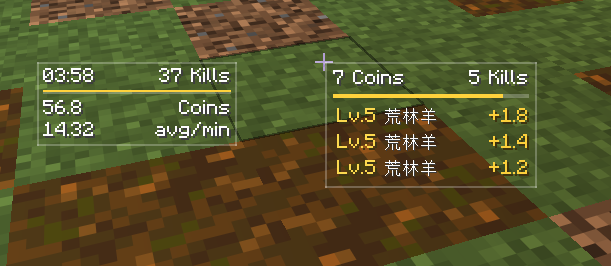
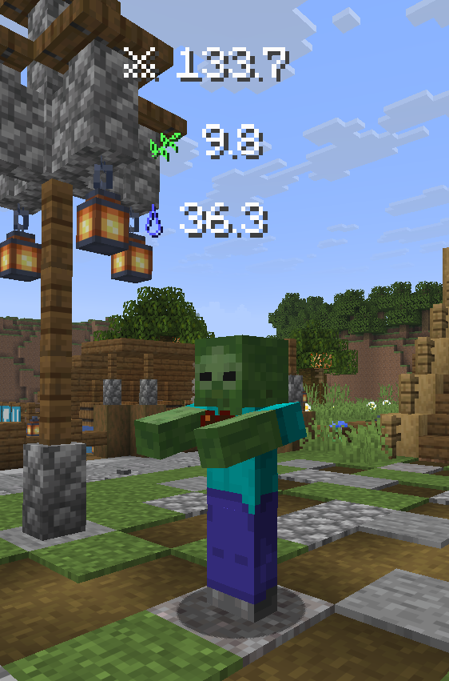
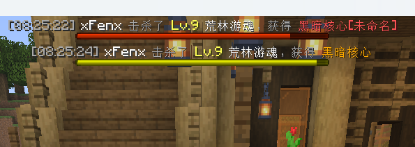
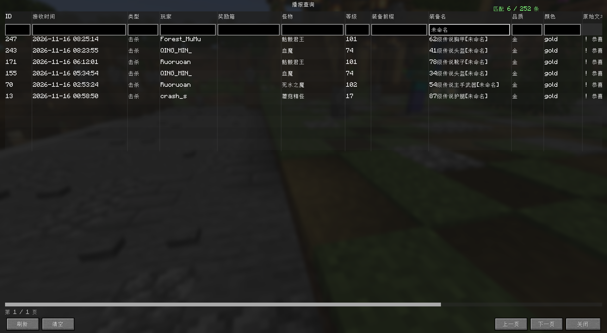

# Crashs Legacy

> 快速跳转：[新手指南](#新手指南) · [功能截图](#功能截图) · [常用命令](#6-常用命令) · [更新日志](CHANGELOG.md)

Minecraft 1.21.11 的轻量客户端功能集合。
专为无名纪行服务器定制的 击杀反馈（金币） 服务器伤害显示管理 金币统计 出货播报管理

# 功能截图

## 击杀反馈与金币统计

`KillFeedback` 负责击杀金币反馈；`金币统计` 独立显示会话时长、总击杀、总金币与平均值。



## 服务器伤害数字

识别服务器生成的伤害 TextDisplay，并支持背景透明、阴影和玩家受伤文本。



## 播报 BossBar

支持本玩家/其他玩家、关键词/红色/其他分类，以及分类独立的 BossBar、聊天拦截、时间和音效。



## 播报查询

按列筛选 SQLite/CSV 记录，支持分页、tooltip 和复制原始文本。



## 功能概览

- 击杀反馈：金币解析、统计窗口、HUD 列表、连杀音效和 C3 宽度稳定
- 金币统计：独立会话 HUD、会话时间、总击杀、总金币、平均值、数字滚动
- 服务器伤害显示：TextDisplay 伤害文本、玩家受伤文本、背景透明、阴影和移除
- 播报管理：本玩家/其他玩家、关键词/红色/其他分类、独立聊天/BossBar/时间/音效
- 播报存储：CSV 与 SQLite，SQLite 仅保留 Windows x64 native
- 播报查询：按列筛选、分页、tooltip、复制原始文本
- 快捷键：F7 打开 Crashs Legacy 功能菜单

# 新手指南

## 0. 最简易的教程

安装: 扔到mods文件夹里 
游戏版本1.21.11 fabric 需要安装fabric api和fabric language kotlin 无需任何其他前置 默认按F7打开配置界面（可在游戏自带快捷键设置处修改）
## 1. 准备环境

安装：

```text
Minecraft 1.21.11
Fabric Loader
Fabric API 1.21.11 版本
Fabric Language Kotlin
Java 21
```

## 2. 安装模组

把：

```text
crashs-legacy-1.11.9+1.21.11.jar
```

放入客户端：

```text
.minecraft/mods/
```

同时确认 `mods/` 中已有：

```text
Fabric API
Fabric Language Kotlin
```

不要安装到服务器。

## 3. 打开配置编辑器

进入游戏后按聊天键，输入：

```text
/crashs ui
```

会打开 Crashs Legacy 功能菜单，包含：

```text
击杀反馈
服务器伤害显示管理
播报管理
金币统计
播报查询
```

KillFeedback 配置界面包含四个页面：

```text
常规
HUD 与统计
样式
颜色
```

也可以直接打开单个功能：

```text
/killfeedback ui
/damagetext ui
/crashs debugloot <message>
```

常用操作：

```text
修改后点击“保存”
点击“取消”不保存
点击“恢复默认”重置当前草稿
```

## 4. 配置内容

### 常规

```text
启用模块
是否拦截原始消息
是否处理 ActionBar
奖励正则
音效开关
音效音量/音调
连杀音效组
收尾模式
指定音效
```

### HUD 与统计

```text
HUD 开关
缩放
右上角对齐
X/Y 百分比位置
头部样式
背景
进度条
统计窗口
最大行数
条目持续时间
```

### 样式

```text
显示金币/击杀/来源/等级/金额
数字格式
统计模式
行间距
待淘汰透明度
进度条高度
金额滚动
```

### 颜色

颜色使用：

```text
#AARRGGBB
```

例如：

```text
#FFFFFFFF
#FFFFD23C
```

### 服务器伤害

```text
启用服务器伤害显示管理
背景透明
移除伤害显示
字体阴影
```

只处理识别出的十种服务器元素伤害 TextDisplay。

## 5. 默认奖励格式

默认识别：

```text
! 你获得了 2 金币，来自于 Lv.5 荒林羊
! 你获得了 2 金币 (VIP加成)，来自于 Lv.5 荒林羊
```

也兼容：

```text
! 你获得了 2 金币，来自 Lv.5 荒林羊
```

如果服务器格式不同：

```text
/killfeedback ui
→ 常规 → 奖励正则
```

修改后保存。

## 6. 常用命令

```text
/crashs ui                    打开 Crashs Legacy 功能菜单
/crashs debugloot <message>   把文本组件送入播报入口调试
/killfeedback ui              打开 KillFeedback 配置
/damagetext ui                打开服务器伤害显示配置
```

也可以直接在游戏中按：

```text
F7
```

打开 Crashs Legacy 功能菜单。

`F7` 可在原版按键设置的独立 `Crashs Legacy` 分类中修改。

手动编辑：

```text
config/crashs-legacy.json
```

保存后重启客户端生效。

## 7. 看不到 HUD 或消息

依次检查：

```text
1. 是否已进入服务器
2. KillFeedback 配置中 enabled 是否为 true
3. hud 是否为 true
4. 服务器消息是否符合默认正则
5. 是否安装了其他拦截聊天消息的模组
```

---

## 环境

```text
Minecraft 1.21.11
Fabric Loader 0.20.1
Fabric API 0.141.6+1.21.11
Fabric Language Kotlin 1.14.1+kotlin.2.4.20
Java 21
```

## 安装注意事项

### 1. 仅安装到客户端

这是客户端模组，只需要放进客户端实例：

```text
.minecraft/mods/
```

不需要安装到服务器。

### 2. 必须安装前置

除了本模组 jar，还必须安装：

```text
Fabric API
Fabric Language Kotlin
```

缺少任意一个都会导致模组无法加载。

### 3. 版本必须匹配

本构建只支持：

```text
Minecraft 1.21.11
```

不要用于：

```text
1.21.10
1.21.12
26.3
其他 Minecraft 版本
```

Fabric API 需要使用对应 `1.21.11` 的版本。

### 4. Java 版本

需要：

```text
Java 21
```

使用 Java 17 或更低版本无法启动 1.21.11。

### 5. 替换旧版本

更新时先删除旧的：

```text
crashs-legacy-*.jar（以及旧版 killfeedback-*.jar）
```

只保留一个 KillFeedback jar，避免重复加载。

### 6. 首次启动

首次启动会自动生成：

```text
config/crashs-legacy.json
```

默认配置可以直接使用。

### 7. 配置文件迁移

升级版本后：

```text
旧配置缺少的新字段会自动补默认值
旧默认正则会自动迁移
```

如果配置损坏，可以删除配置文件后重启，或执行：

```text
/killfeedback ui
```

建议升级前备份：

```text
config/crashs-legacy.json
```

### 8. 消息不显示或被拦截

如果奖励消息没有进入 HUD：

```text
/killfeedback ui
```

检查：

```text
enabled
intercept
pattern
```

如果服务器消息格式不同，需要修改正则：

```text
/killfeedback ui
```

在“常规”页面编辑“奖励正则”。

### 9. 音效

音效资源已经打包在 jar 内，不需要额外资源包。

音量仍然受 Minecraft 主音量控制：

```text
设置 → 声音 → 主音量
```

本模组的“音效音量”和“音调”是额外倍率。

### 10. 与其他模组冲突

如果同时安装其他会取消聊天消息的模组，可能出现：

```text
消息被另一个模组先取消
本模组收不到奖励
```

建议只保留一个处理同类奖励消息的模组。

### 11. 服务端规则

本模组只修改客户端显示和音效，不修改服务器数据。

在多人服务器使用前，请确认服务器规则允许客户端模组。

## 构建

```bash
gradlew.bat build
```

产物：

```text
build/libs/crashs-legacy-1.11.9+1.21.11.jar
```

将 jar 放入游戏实例的 `mods/` 目录。

需要同时安装：

```text
Fabric API
Fabric Language Kotlin
```

## 本地运行

不预设开发玩家名，使用 Fabric 默认行为：

```bash
gradlew.bat runClient
```

需要临时指定名称时：

```bash
gradlew.bat runClient --args="--username xFenx"
```

## 功能

- 监听系统聊天和 ActionBar 消息
- 解析击杀奖励金币与怪物来源
- 统计总金币、击杀数
- 统计窗口与进度条
- 最近奖励列表
- 连杀音效
- 音效分组、收尾策略和指定音效
- HUD 位置、缩放、背景、列表样式
- 配置保存到 `config/crashs-legacy.json`
- 断开连接时清空统计

默认识别的消息格式：

```text
! 你获得了 123 金币，来自 Lv.10 僵尸
```

## 命令

```text
/crashs ui
```

打开功能菜单：

```text
KillFeedback 击杀反馈
服务器伤害显示管理
```

单独打开：

```text
/killfeedback ui
/damagetext ui
```

`/killfeedback` 不再提供旧的状态、开关、正则等子命令。

## 配置界面

KillFeedback：

```text
/killfeedback ui
```

页面：

```text
常规
HUD 与统计
样式
颜色
```

服务器伤害显示：

```text
/damagetext ui
```

页面：

```text
启用服务器伤害显示管理
背景透明
移除伤害显示
字体阴影
```

修改后点击“保存”；“取消”不写入；“恢复默认”只重置当前功能。

## 配置

文件：

```text
config/crashs-legacy.json
```

主要字段：

```json
{
  "enabled": true,
  "intercept": true,
  "includeOverlay": false,
  "pattern": "默认正则",
  "sound": true,
  "soundVolume": 1.0,
  "soundPitch": 1.0,
  "comboGroup": "NONE",
  "postMode": "SPECIFIC",
  "specificSound": "KILL_DF",
  "hud": true,
  "hudScale": 1.0,
  "hudRight": false,
  "hudX": 50.0,
  "hudY": 50.0,
  "statsWindowSeconds": 8.0,
  "maxRows": 5,
  "entryDurationSeconds": 5.0,
  "headerStyle": "FULL",
  "background": false,
  "showProgress": true,
  "serverDamageEnabled": true,
  "serverDamageBackground": true,
  "serverDamageRemove": false,
  "serverDamageShadow": true
}
```

保存后重启客户端生效。

## P2 HUD 功能

HUD 与统计页面新增：

```text
显示金币 / 击杀 / 来源 / 等级 / 金额
数字格式 RAW / COMMA / SHORT
统计模式 TIMED / SESSION
行间距
待淘汰透明度
进度条高度
金额滚动
```

`样式` 页面集中管理：

```text
显示开关
数字格式
统计模式
行间距
待淘汰透明度
进度条高度
金额滚动
```

`颜色` 页面使用 `#AARRGGBB` 格式：

```text
金币颜色
来源颜色
等级颜色
头部颜色
进度条颜色
进度背景
背景颜色
边框颜色
分隔线颜色
```

## 音效控制

General 页面新增：

```text
音效音量 0~100%
音效音调 0.5~2.0
```

最终音量仍受 Minecraft 主音量控制。

## HUD 样式

`headerStyle`：

```text
FULL
COMPACT
COINS_ONLY
KILLS_ONLY
HIDDEN
```

`hudRight` 为 `true` 时按右侧坐标计算，否则按左侧坐标计算。

`hudX` / `hudY` 使用屏幕百分比：

```text
0   = 锚定边缘
100 = 另一侧边缘
```

默认 `hudRight = false`、`hudX = 50`、`hudY = 50`，即屏幕中央位置。

## 音效

音效资源位于：

```text
assets/crashs-legacy/sounds/killfeed/
```

包含：

- CF 连杀
- Valorant 系列击杀音效
- Battlefield / Delta Force 风格击杀、爆头、命中音效

`comboGroup` 可选值：

```text
NONE
CF
VALORANT_BUBBLEGUM
VALORANT_CHAMPIONS
VALORANT_GAIA
VALORANT_GAIA_VENGEANCE
VALORANT_GLITCHPOP
VALORANT_PRELUDE
VALORANT_PRIME
VALORANT_PRIMORDIUM
VALORANT_RADIANT_CRISIS
VALORANT_RGX
VALORANT_SINGULARITY
```

`postMode`：

```text
LOOP_GROUP
LAST_OF_GROUP
NONE
SPECIFIC
```

## 实现说明

- 客户端 Mixin 拦截 `ClientPlayNetworkHandler.onGameMessage` 与 `onOverlayMessage`
- 解析成功后按配置决定是否取消原消息
- HUD 使用原版 `DrawContext` 绘制，不依赖第三方 UI 库
- 配置使用 Gson
- 音效使用原版 `SoundEvent` / `SoundManager`

## 已知限制

- 默认正则匹配 `! 你获得了 ... 金币，来自 ...`，并支持金币后的 VIP/加成括号说明
- 其他服务器消息格式需要修改 `pattern`
- 没有配置界面，使用命令与 JSON
- HUD 字体使用原版字体，不包含自定义字体渲染
- 当前只支持 1.21.11

## 许可证

GPL-3.0-or-later，见 `LICENSE`。

